Ran command: `python -c "
from app import app
routes = []
for rule in app.url_map.iter_rules():
    if rule.endpoint != 'static':
        methods = ','.join(sorted(rule.methods - {'HEAD', 'OPTIONS'}))
        routes.append((rule.rule, rule.endpoint, methods))
routes.sort(key=lambda x: x[0])
for r, ep, m in routes:
    print(f'{r:<35} | {ep:<30} | {m}')
"`
Viewed admin_routes.py:1-70

Dưới đây là **Bản đồ các Route (Route Map)** của hệ thống web, được phân nhóm theo Blueprint và ma trận phân quyền (RBAC):

---

### 1. Sơ đồ tổng quan kiến trúc Route (Mermaid Diagram)

```mermaid
graph TD
    Root["Hệ thống Web BĐS (Flask App)"]

    %% PUBLIC BLUEPRINT
    Root --> Public["🌐 Public (Khách & Người dùng)"]
    Public --> P1["GET /<br/><i>public.index</i><br/>Sàn BĐS URBN & Bộ lọc"]
    Public --> P2["GET /property/&lt;id&gt;<br/><i>public.property_detail</i><br/>Chi tiết BĐS & Hotline cá nhân"]

    %% AUTH BLUEPRINT
    Root --> Auth["🔐 Auth (Xác thực & Cá nhân)"]
    Auth --> A1["GET, POST /login<br/><i>auth.login</i>"]
    Auth --> A2["GET, POST /register<br/><i>auth.register</i>"]
    Auth --> A3["GET /logout<br/><i>auth.logout</i>"]
    Auth --> A4["GET, POST /profile<br/><i>auth.profile</i> (Logo, Hotline)"]

    %% MEMBER BLUEPRINT
    Root --> Member["👔 Member (Nhân sự kinh doanh)"]
    Member --> M1["GET /dashboard/properties<br/><i>member.my_properties</i>"]
    Member --> M2["GET, POST /dashboard/properties/new<br/><i>member.create_property</i>"]
    Member --> M3["GET, POST /dashboard/properties/&lt;id&gt;/edit<br/><i>member.edit_property</i>"]
    Member --> M4["POST /dashboard/properties/&lt;id&gt;/delete<br/><i>member.delete_property</i>"]

    %% MANAGER BLUEPRINT
    Root --> Manager["🛡️ Manager (Trưởng phòng duyệt bài)"]
    Manager --> MG1["GET /dashboard/manager/approvals<br/><i>manager.approval_list</i>"]
    Manager --> MG2["GET /dashboard/manager/approvals/&lt;id&gt;/diff<br/><i>manager.review_diff</i> (So sánh Side-by-Side)"]
    Manager --> MG3["POST /dashboard/manager/approvals/&lt;id&gt;/approve<br/><i>manager.approve</i>"]
    Manager --> MG4["POST /dashboard/manager/approvals/&lt;id&gt;/reject<br/><i>manager.reject</i>"]

    %% ADMIN BLUEPRINT
    Root --> Admin["👑 Admin (Quản trị hệ thống)"]
    Admin --> AD1["GET /dashboard/admin/users<br/><i>admin.user_management</i>"]
    Admin --> AD2["POST /dashboard/admin/users/&lt;id&gt;/toggle-active<br/><i>admin.toggle_user_active</i>"]
    Admin --> AD3["POST /dashboard/admin/users/&lt;id&gt;/update<br/><i>admin.update_user</i>"]
    Admin --> AD4["GET /dashboard/admin/all-approvals<br/><i>admin.all_approvals</i>"]
```

---

### 2. Bảng tra cứu chi tiết các Route

| URL Path | Tên Endpoint (`url_for`) | Methods | Phân quyền (RBAC) | Chức năng chính |
| :--- | :--- | :---: | :---: | :--- |
| **🌐 Public Blueprint (`public_bp`)** | | | | |
| `/` | [`public.index`](file:///home/dinhbinhnguyen/Devs/my-manager.web.v2/routes/public_routes.py) | `GET` | Mọi người | Trang chủ giao diện URBN, xem BĐS đã duyệt, lọc theo giá, diện tích, loại hình, hướng, từ khóa. |
| `/property/<property_id>` | [`public.property_detail`](file:///home/dinhbinhnguyen/Devs/my-manager.web.v2/routes/public_routes.py) | `GET` | Mọi người | Xem chi tiết 1 BĐS, bảo vệ quyền môi giới với số hotline & liên hệ Zalo của người đăng. |
| **🔐 Auth Blueprint (`auth_bp`)** | | | | |
| `/login` | [`auth.login`](file:///home/dinhbinhnguyen/Devs/my-manager.web.v2/routes/auth_routes.py) | `GET`, `POST` | Khách vãng lai | Đăng nhập tài khoản nhân sự nội bộ. |
| `/register` | [`auth.register`](file:///home/dinhbinhnguyen/Devs/my-manager.web.v2/routes/auth_routes.py) | `GET`, `POST` | Khách vãng lai | Đăng ký nhân sự mới (mặc định trạng thái chờ Admin kích hoạt). |
| `/logout` | [`auth.logout`](file:///home/dinhbinhnguyen/Devs/my-manager.web.v2/routes/auth_routes.py) | `GET` | Đã đăng nhập | Đăng xuất khỏi phiên làm việc. |
| `/profile` | [`auth.profile`](file:///home/dinhbinhnguyen/Devs/my-manager.web.v2/routes/auth_routes.py) | `GET`, `POST` | Đã đăng nhập | Cập nhật thông tin cá nhân, số hotline, mật khẩu và upload ảnh logo thương hiệu riêng. |
| **👔 Member Dashboard (`member_bp`)** | | | | |
| `/dashboard/properties` | [`member.my_properties`](file:///home/dinhbinhnguyen/Devs/my-manager.web.v2/routes/member_routes.py) | `GET` | `PROBATION`, `MEMBER`, `MANAGER`, `ADMIN` | Quản lý danh sách BĐS cá nhân (xem trạng thái `approved`, `pending`, `rejected`). |
| `/dashboard/properties/new` | [`member.create_property`](file:///home/dinhbinhnguyen/Devs/my-manager.web.v2/routes/member_routes.py) | `GET`, `POST` | `PROBATION`, `MEMBER`, `MANAGER`, `ADMIN` | Tạo bài đăng BĐS mới (Member: tạo chờ duyệt; Admin: duyệt hiển thị ngay). |
| `/dashboard/properties/<prop_id>/edit` | [`member.edit_property`](file:///home/dinhbinhnguyen/Devs/my-manager.web.v2/routes/member_routes.py) | `GET`, `POST` | Chủ sở hữu / `ADMIN` | Chỉnh sửa BĐS (nếu bài đã duyệt sẽ tạo bản nháp độc lập để Quản lý duyệt trước khi ghi đè). |
| `/dashboard/properties/<prop_id>/delete` | [`member.delete_property`](file:///home/dinhbinhnguyen/Devs/my-manager.web.v2/routes/member_routes.py) | `POST` | `MEMBER`, `MANAGER`, `ADMIN` *(chặn `PROBATION`)* | Xóa BĐS (nếu bài đã approved sẽ gửi yêu cầu duyệt xóa đến Manager; Admin xóa ngay). |
| **🛡️ Manager Dashboard (`manager_bp`)** | | | | |
| `/dashboard/manager/approvals` | [`manager.approval_list`](file:///home/dinhbinhnguyen/Devs/my-manager.web.v2/routes/manager_routes.py) | `GET` | `MANAGER`, `ADMIN` | Xem danh sách các yêu cầu tạo/sửa/xóa đang chờ duyệt thuộc nhóm phụ trách. |
| `/dashboard/manager/approvals/<pending_id>/diff` | [`manager.review_diff`](file:///home/dinhbinhnguyen/Devs/my-manager.web.v2/routes/manager_routes.py) | `GET` | `MANAGER`, `ADMIN` | Giao diện đối chiếu so sánh trực quan (Side-by-Side Diff) giữa bài gốc và dữ liệu đề xuất sửa. |
| `/dashboard/manager/approvals/<pending_id>/approve` | [`manager.approve`](file:///home/dinhbinhnguyen/Devs/my-manager.web.v2/routes/manager_routes.py) | `POST` | `MANAGER`, `ADMIN` | Phê duyệt yêu cầu đăng bài / cập nhật / gỡ bài. |
| `/dashboard/manager/approvals/<pending_id>/reject` | [`manager.reject`](file:///home/dinhbinhnguyen/Devs/my-manager.web.v2/routes/manager_routes.py) | `POST` | `MANAGER`, `ADMIN` | Từ chối yêu cầu kèm lý do gửi lại cho nhân sự chỉnh sửa. |
| **👑 Admin Dashboard (`admin_bp`)** | | | | |
| `/dashboard/admin/users` | [`admin.user_management`](file:///home/dinhbinhnguyen/Devs/my-manager.web.v2/routes/admin_routes.py) | `GET` | `ADMIN` | Quản lý danh sách toàn bộ tài khoản nhân sự trong công ty. |
| `/dashboard/admin/users/<user_id>/update` | [`admin.update_user`](file:///home/dinhbinhnguyen/Devs/my-manager.web.v2/routes/admin_routes.py) | `POST` | `ADMIN` | Thay đổi chức vụ (`role`) và nhóm làm việc (`group_id`) của nhân sự. |
| `/dashboard/admin/users/<user_id>/toggle-active` | [`admin.toggle_user_active`](file:///home/dinhbinhnguyen/Devs/my-manager.web.v2/routes/admin_routes.py) | `POST` | `ADMIN` | Kích hoạt (duyệt đăng ký) hoặc vô hiệu hóa khóa tài khoản nhân sự. |
| `/dashboard/admin/all-approvals` | [`admin.all_approvals`](file:///home/dinhbinhnguyen/Devs/my-manager.web.v2/routes/admin_routes.py) | `GET` | `ADMIN` | Xem danh sách chờ duyệt của toàn bộ các nhóm liên phòng ban. |